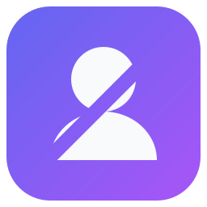
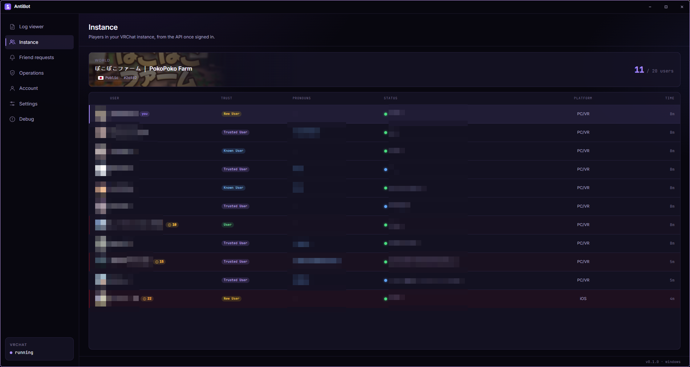
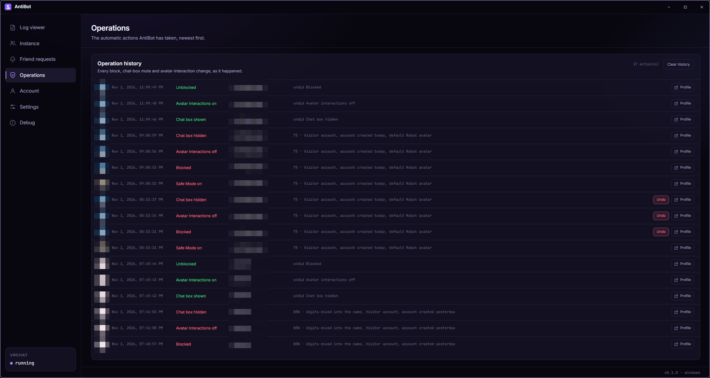
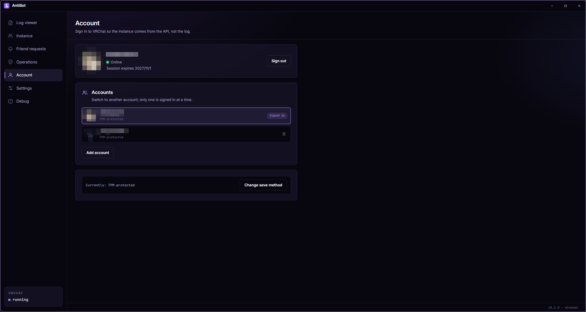

<div align="center">
  
  <h1>AntiBot</h1>
  <p><strong>VRChat のインスタンスからボットを締め出します。</strong></p>
  <p>
    <a href="https://t2penbix99wcoxkv3a4g.github.io/AntiBot/">ウェブサイト</a> ·
    <a href="https://t2penbix99wcoxkv3a4g.github.io/AntiBot/#/docs/Getting-Started">ドキュメント</a>
  </p>
  <p>
    <a href="README.md">English</a> ·
    <a href="README.zh-CN.md">简体中文</a> ·
    <a href="README.zh-TW.md">繁體中文</a>
  </p>
</div>

AntiBot は VRChat がすでに書き出しているログを監視し、インスタンスに誰がいるかを表示し、参加した
すべてのユーザーを採点します。設定したしきい値を超えると、アバターのダウンロードが完了する前に
行動できます。ブロック、アバターインタラクションの無効化、チャットボックスの非表示、OSC 経由の
セーフモード、低リスクなアバターへの切り替え、クライアントの終了です。

MOD、プラグイン、改造した VRChat クライアントは不要です。

<div align="center">
  <a href="docs/instance.png"></a>
  <br>
  <em>インスタンス一覧。すべてのユーザーに脅威度スコアが付きます</em>
  <br><br>
  <a href="docs/operations.png"></a>
  <br>
  <em>すべての自動操作を、理由と元に戻す機能とともに</em>
  <br><br>
  <a href="docs/account.png"></a>
  <br>
  <em>複数アカウントと、保存されたセッション</em>
</div>

## なぜ必要か

パブリックインスタンスは、ボットがアバターや音声データ、アカウントのリンクを見つけるのに都合の
よい場所です。AntiBot は参加したユーザーを採点し、アバターのダウンロードが完了する前に反応する
時間を作ります。

スコアは推測であり、判定ではありません。本物の人間が高いスコアになることも、ボットが低い
スコアになることもあります。理由はそれぞれの点数とともに表示されるため、なぜそのユーザーが
検出されたのかが分かります。

## 機能

- **リアルタイムのインスタンス一覧** — インスタンス内の全員を、信頼レベル、参加時間、
  プラットフォーム、代名詞、脅威度スコアとともに表示します。サインイン後は VRChat API から、
  それ以前はログから取得します。
- **脅威度スコアリング** — アカウントの年齢、信頼レベル、生成された名前のパターン、
  プロフィールの文章、着用中のアバターを採点に反映します。各シグナルは点数とともに表示されます。
- **自動保護** — しきい値に達すると、そのユーザーをブロックし、アバターインタラクションを
  無効化し、チャットボックスを非表示にします。フレンド、ホワイトリストのユーザー、
  自分のアカウントは決して対象になりません。
- **OSC 経由のセーフモード** — ユーザーがしきい値を超えた瞬間に VRChat のパニックボタンを押し、
  フレンド以外のアバターを一括で置き換えます。
- **アバターの切り替え** — 必要に応じて OSC で低リスクなアバター ID に切り替えます。
  自動で戻すことはありません。
- **フレンドリクエスト** — 脅威度の高いフレンドリクエストを拒否し、送信者に同じ
  モデレーション操作を適用します。
- **ログビューア** — VRChat のログをリアルタイムかつ検索可能に表示します。参加、退出、
  アバター関連の行は読みやすいまま残ります。
- **操作履歴** — すべての自動操作を、スコアと理由とともに SQLite に記録します。
  ほとんどの操作は元に戻せます。
- **一括操作** — プロフィールリンクをまとめて貼り付け、有効になっているブロック・アバター操作・
  チャットボックスの操作を全員に適用します。速度制限に合わせたキューと進行状況があります。
- **複数アカウント** — 複数の VRChat アカウントを保持し、切り替えられます。セッションは
  Windows Hello、TPM、DPAPI、システムキーリング、または自分で決めたパスワードの背後に
  保存できます。
- **自動サインイン** — ログイン名とパスワードを TPM または DPAPI で暗号化して保存し、
  セッションが切れたときに再サインインできます。アカウントページで有効にし、自動でサインインするか、
  手動ボタンからのみ使うかを選べます。VRChat が二要素認証やメール確認を求める場合があります。
- **ローカルに保存** — ログ、データベース、設定はすべて自分の PC に残ります。ネットワーク通信は
  VRChat API と、設定したアバター名プロバイダーにのみ行われます。

## 使用技術

- **.NET 10 上の C#** — ログの読み取り、VRChat API との通信、採点、モデレーション、OSC、
  ローカルデータベースなど、すべてのロジック。
- **React 19 + TypeScript**、 **Vite** でバンドルし **styled-components** でスタイルを適用 —
  インターフェース。C# 側と JSON メッセージを交換するだけで、自身では処理を行いません。
- **Photino.NET** — デスクトップシェル。OS 自身の WebView にインターフェースを表示するため、
  WebView は実行時の依存関係です。Windows では WebView2、Linux では WebKitGTK です。
- **SQLite** — インスタンスイベント、プレイヤープロフィール、フレンドリクエスト、操作履歴。

## 実行

公開ビルドは **自己完結型**で、.NET ランタイムを同梱しているため追加のインストールは不要です。
OS 側で必要なものは以下です。

配布アーカイブとは別に、4 種類のパッケージが公開されます。

| ファイル                                 | 内容                                                                                                                                                                              |
|------------------------------------------|-----------------------------------------------------------------------------------------------------------------------------------------------------------------------------------|
| `AntiBot-<version>-win-x64.msi`          | ユーザー単位の Windows インストーラー：`%LOCALAPPDATA%\Programs\AntiBot` にインストールし、スタートメニューとデスクトップのショートカットを追加します。管理者権限は要求しません。 |
| `antibot-<version>-1.fcXX.x86_64.rpm`    | Fedora パッケージ：`sudo dnf install ./antibot-<version>-*.rpm`。`/opt/AntiBot` にインストールし、`antibot` コマンド、デスクトップエントリ、アイコンを含みます。                  |
| `antibot_<version>_amd64.deb`            | Debian/Ubuntu パッケージ：`sudo apt install ./antibot_<version>_amd64.deb`。レイアウトは RPM と同じです。                                                                         |
| `antibot-<version>-1-x86_64.pkg.tar.zst` | Arch Linux パッケージ：`sudo pacman -U antibot-<version>-1-x86_64.pkg.tar.zst`。レイアウトは RPM と同じです。                                                                     |

### Windows

1. Microsoft Edge **WebView2 ランタイム**。Windows 10 と 11 には通常含まれています。ない場合は
   [Microsoft のページ](https://developer.microsoft.com/microsoft-edge/webview2/)を使用して
   ください。
2. Windows 10 以降、x64。
3. このビルドはコード署名されていないため、初回起動時に Windows が警告を表示することがあります。

### Linux

1. GTK 用の WebView。
2. AppIndicator ライブラリ。システムトレイのアイコンにのみ必要です。なくてもアプリは動作しますが、
   トレイがなくなり、メインウィンドウが表示されたままになります。
3. 自己完結型ビルドが必要とする .NET ランタイムライブラリ（ICU、OpenSSL、zlib、krb5、fontconfig、
   freetype）はパッケージに含まれます。単体のアーカイブを使う場合は手動でインストールしてください。

| ディストリビューション | パッケージ                                                                   |
|------------------------|------------------------------------------------------------------------------|
| Fedora                 | `sudo dnf install webkit2gtk4.1 libayatana-appindicator-gtk3 libnotify`      |
| Debian / Ubuntu        | `sudo apt install libwebkit2gtk-4.1-0 libayatana-appindicator3-1 libnotify4` |
| Arch Linux             | `sudo pacman -S webkit2gtk-4.1 libayatana-appindicator`                      |
| その他                 | 以下のライブラリを提供するパッケージを探してください                         |

```
libwebkit2gtk-4.1.so.0          libjavascriptcoregtk-4.1.so.0
libgtk-3.so.0                   libglib-2.0.so.0
libayatana-appindicator3.so.1   （または古い libappindicator3.so.1）
```

WebView ライブラリがない場合、起動時に `Unable to load shared library 'Photino.Native'` と表示
されます。不足している soname を提供するパッケージを調べるには、パッケージマネージャーに問い
合わせてください。例えば `dnf provides 'libwebkit2gtk-4.1.so.0'`、
`apt-file search libwebkit2gtk-4.1.so.0`、`pacman -F libwebkit2gtk-4.1.so.0` です。

## 初回起動

1. 普段使っている VRChat アカウントで **サインイン**します。VRChat が要求したときに、メール
   コードと二要素認証コードを尋ねます。パスワードはそのリクエストに使われ、自動サインインを
   有効にした場合のみ暗号化して保存されます。
2. **ログフォルダを指定します。** 既定は VRChat 自身のフォルダです。Windows では
   `%USERPROFILE%\AppData\LocalLow\VRChat\VRChat`、Linux では Proton のプレフィックスを自動的に
   見つけます。AntiBot はそこにある最新の `output_log_*.txt` を追従します。
3. **0〜100 のしきい値を設定します。** しきい値未満では何も行われず、各スコアの理由は一覧に
   表示されます。
4. **アクションを選びます。** **設定 → 自動保護**で必要なものを有効にします。セーフモードと
   アバターの切り替えには OSC が必要で、それ以外は OSC なしで動作します。

詳しい手順は[ドキュメント](https://t2penbix99wcoxkv3a4g.github.io/AntiBot/#/docs/Getting-Started)
を参照してください。

## ビルド

- [.NET 10 SDK](https://dotnet.microsoft.com/download)
- [Node.js](https://nodejs.org/) 20 以降（インターフェースのビルド用）
- `AntiBot/Libs` の共有 DLL とフロントエンド bridge パッケージ。別プロジェクトの
  [PhotinoNETUtils](../PhotinoNETUtils) から `build-and-copy.ps1` でコピーします

## ビルドと実行

### 開発

インターフェースは Vite が配信するため、両方を起動します：

```bash
# ターミナル 1 — インターフェース (http://127.0.0.1:3200)
cd AntiBot/UserInterface
npm install
npm run dev

# ターミナル 2 — デスクトップアプリ
dotnet run --project AntiBot
```

Debug ビルドは開発サーバーからインターフェースを読み込みます。「デバッグ」ページは Debug
ビルドでのみ提供されます。

### リリース

`npm run build` はインターフェースを `AntiBot/Resources/wwwroot` にコピーし、プロジェクトが
それを実行ファイルに埋め込みます。そのため公開前にインターフェースをビルドしてください。

```bash
cd AntiBot/UserInterface && npm run build
cd ../.. && dotnet publish AntiBot/AntiBot.csproj -c Release -r win-x64
```

Linux では `-r linux-x64` を使用します。`AntiBot/bin/Release/net10.0/<rid>/publish/` に、
プラットフォームごとの自己完結型実行ファイルが 1 つ生成されます。

## データの保存場所

|                    | Windows                                | Linux                                  |
|--------------------|----------------------------------------|----------------------------------------|
| 設定               | `%APPDATA%\AntiBot\settings.json`      | `~/.config/AntiBot/settings.json`      |
| データベース       | `%APPDATA%\AntiBot\antibot.db`         | `~/.config/AntiBot/antibot.db`         |
| アカウント         | `%LOCALAPPDATA%\AntiBot\accounts`      | `~/.local/share/AntiBot/accounts`      |
| WebView            | `%LOCALAPPDATA%\AntiBot\webview`       | `~/.local/share/AntiBot/webview`       |
| 抽出されたアイコン | `%LOCALAPPDATA%\AntiBot\icon.ico`      | `~/.local/share/AntiBot/icon.png`      |
| ログ               | `%APPDATA%\AntiBot\logs\antibot-*.log` | `~/.config/AntiBot/logs/antibot-*.log` |

各アカウントはセッション、salt、保存方法を専用フォルダに保持し、フォルダ名はアカウント ID の
ハッシュです。アカウント索引には表示名と最終使用日時だけが保存されます。

ログはファイルに書き込まれ、コンソールにも複製されるため、問題報告にはログファイルだけで
足ります。毎日ローテーションし、直近 7 日分を保持します。30 日を超えたインスタンスイベントは
起動時に削除されます。

## 注意事項

- VRChat は同じマシンで実行されている必要があります。AntiBot はそのログを読むため、VRChat が
  インスタンスにいる間だけ、そのインスタンスを認識できます。
- インスタンス一覧はサインイン後は API から、それ以外はログから取得します。所有していない
  インスタンスでは API のロスターが一部のみのことがあるため、そこではログも使用します。
- ウィンドウを閉じるとアプリはシステムトレイに格納されます。起動時から非表示にするには、設定の **非表示で起動**
  を有効にしてください。トレイがない場合は常にウィンドウを表示します。
- API は数秒に 1 回程度のモデレーションリクエストしか許可しません。AntiBot はそのペースを守り、
  拒否されたリクエストは破棄せず再試行します。

## クレジット

- **[VRCX](https://github.com/vrcx-team/VRCX)** — VRChat API 統合の大部分は VRCX の実装を参考に
  しています。エンドポイント、サインインと二要素認証の流れ、モデレーション操作、アバター検索の
  形式、ログ解析の一部が含まれます。VRCX の MIT ライセンスは
  [LICENSE_VRCX](LICENSE_VRCX) に収録しています。

## ライセンス

MIT — [LICENSE](LICENSE) を参照してください。
