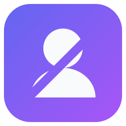
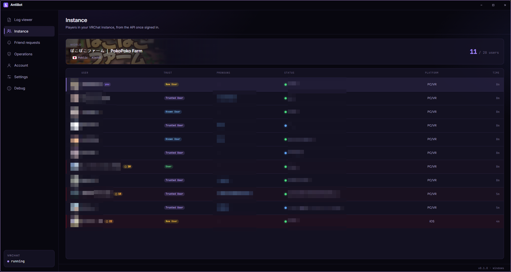
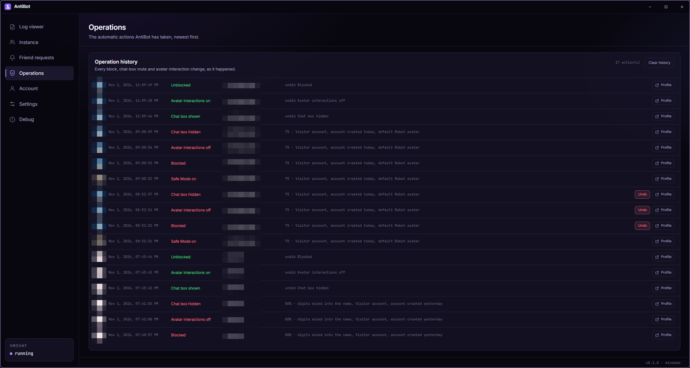
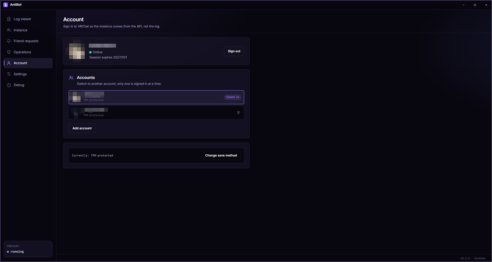

<div align="center">
  
  <h1>AntiBot</h1>
  <p><strong>Keep bots out of your VRChat instance.</strong></p>
  <p>
    <a href="https://t2penbix99wcoxkv3a4g.github.io/AntiBot/">Website</a> ·
    <a href="https://t2penbix99wcoxkv3a4g.github.io/AntiBot/#/docs/Getting-Started">Documentation</a>
  </p>
  <p>
    <a href="README.ja.md">日本語</a> ·
    <a href="README.zh-CN.md">简体中文</a> ·
    <a href="README.zh-TW.md">繁體中文</a>
  </p>
</div>

AntiBot watches the log VRChat already writes, shows who is in your instance, and scores every user
who joins. Above a threshold you choose it can act before their avatar finishes loading: block them,
turn their avatar interactions off, hide their chat box, press Safe Mode over OSC, switch to a
low-risk avatar, or close the client.

It needs no mod, plugin or patched VRChat client.

<div align="center">
  <a href="docs/instance.png"></a>
  <br>
  <em>The instance list, with a score for every user</em>
  <br><br>
  <a href="docs/operations.png"></a>
  <br>
  <em>Every automatic action, with reasons and undo</em>
  <br><br>
  <a href="docs/account.png"></a>
  <br>
  <em>Accounts, with a stored session</em>
</div>

## Why

Public instances are a good place for bots to find avatars, voice data and account links. AntiBot
scores the users who join and gives you a moment to react before an avatar finishes downloading.

The score is a guess, not a verdict: a real person can score high, and a bot can score low. Every
reason is shown with its own points, so you can see why a user was flagged.

## Features

- **Live instance list** — everyone in the instance with trust rank, join time, platform, pronouns
  and a threat score. The list comes from the VRChat API once signed in, and from the log before that.
- **Threat scoring** — account age, trust rank, generated-name patterns, profile text and the worn
  avatar are weighed into a score. Each signal is listed with its points.
- **Automatic protection** — at your threshold, block the user, disable their avatar interactions
  and hide their chat box. Friends, whitelisted users and your own account are never touched.
- **Safe Mode over OSC** — press VRChat's panic button the moment a user crosses the threshold, so
  every non-friend avatar is replaced at once.
- **Avatar switch** — optionally switch yourself to a low-risk avatar id over OSC. It is not
  switched back automatically.
- **Friend requests** — high-threat friend requests are rejected, and the same moderation actions are
  applied to the sender.
- **Log viewer** — a live, searchable view of VRChat's log, with the join, leave and avatar lines kept
  readable.
- **Operation history** — every automatic action is recorded in SQLite, with the score and its
  reasons. Most actions can be undone.
- **Batch actions** — paste a list of profile links and apply the enabled block, avatar-interaction
  and chat-box actions to everyone in it, through a paced queue with a progress bar.
- **Multiple accounts** — keep several VRChat accounts and switch between them. A session can be
  stored behind Windows Hello, the TPM, DPAPI, the system keyring or a password you choose.
- **Automatic sign-in** — optionally keep the login name and password encrypted by the TPM or DPAPI,
  so an expired session can sign in again without asking. VRChat may still ask for a two-factor code.
- **Stays local** — the log, the database and the settings stay on your PC. Network calls go only to
  the VRChat API and the avatar-name providers you have configured.

## Built with

- **C# on .NET 10** — all of the logic: reading the log, talking to the VRChat API, scoring,
  moderation, OSC and the local database.
- **React 19 + TypeScript**, bundled by **Vite** and styled with **styled-components** — the
  interface. It exchanges JSON messages with the C# side and does no work of its own.
- **Photino.NET** — the desktop shell. It shows the interface in the operating system's own web
  view, which is why the web view is a runtime dependency: WebView2 on Windows, WebKitGTK on Linux.
- **SQLite** — the instance events, player profiles, friend requests and operation history.

## Running

The published builds are **self-contained** — they bundle the .NET runtime, so nothing needs to be
installed for them. What the operating system still has to provide is listed below.

Four package formats are published beside the plain archives:

| File                                     | What it does                                                                                                                                                 |
|------------------------------------------|--------------------------------------------------------------------------------------------------------------------------------------------------------------|
| `AntiBot-<version>-win-x64.msi`          | Per-user Windows installer: installs into `%LOCALAPPDATA%\Programs\AntiBot`, adds Start menu and desktop shortcuts, and never asks for administrator rights. |
| `antibot-<version>-1.fcXX.x86_64.rpm`    | Fedora package: `sudo dnf install ./antibot-<version>-*.rpm`. Installs to `/opt/AntiBot` with an `antibot` command, a desktop entry and the icon.            |
| `antibot_<version>_amd64.deb`            | Debian/Ubuntu package: `sudo apt install ./antibot_<version>_amd64.deb`. Same layout as the RPM.                                                             |
| `antibot-<version>-1-x86_64.pkg.tar.zst` | Arch Linux package: `sudo pacman -U antibot-<version>-1-x86_64.pkg.tar.zst`. Same layout as the RPM.                                                         |

### Windows

1. The Microsoft Edge **WebView2 Runtime**. Windows 10 and 11 normally already have it; otherwise
   use [Microsoft's page](https://developer.microsoft.com/microsoft-edge/webview2/).
2. Windows 10 or newer, x64.
3. The build is not code-signed, so Windows may warn the first time it is started.

### Linux

1. The web view for GTK.
2. An AppIndicator library, for the tray icon only. Without it the app still runs; it just has no
   tray and keeps its main window visible instead.
3. The .NET runtime libraries the self-contained build needs (ICU, OpenSSL, zlib, krb5, fontconfig,
   freetype) are pulled in by the packages. A plain archive needs them installed by hand.

| Distribution    | Packages                                                                     |
|-----------------|------------------------------------------------------------------------------|
| Fedora          | `sudo dnf install webkit2gtk4.1 libayatana-appindicator-gtk3 libnotify`      |
| Debian / Ubuntu | `sudo apt install libwebkit2gtk-4.1-0 libayatana-appindicator3-1 libnotify4` |
| Arch Linux      | `sudo pacman -S webkit2gtk-4.1 libayatana-appindicator`                      |
| anything else   | find whatever provides the libraries below                                   |

```
libwebkit2gtk-4.1.so.0          libjavascriptcoregtk-4.1.so.0
libgtk-3.so.0                   libglib-2.0.so.0
libayatana-appindicator3.so.1   (or the older libappindicator3.so.1)
```

A missing web view library shows up as `Unable to load shared library 'Photino.Native'` at startup.
To find the package that owns a missing soname, ask your package manager — for example
`dnf provides 'libwebkit2gtk-4.1.so.0'`, `apt-file search libwebkit2gtk-4.1.so.0`, or
`pacman -F libwebkit2gtk-4.1.so.0`.

## First run

1. **Sign in** with the VRChat account you play with. AntiBot asks for the email and two-factor codes
   when VRChat does. The password is used for that request and is only kept, encrypted, if you turn
   on automatic sign-in.
2. **Point it at the log folder.** The default is VRChat's own folder:
   `%USERPROFILE%\AppData\LocalLow\VRChat\VRChat` on Windows; on Linux the Proton prefix is found
   automatically. AntiBot tails the newest `output_log_*.txt` there.
3. **Set a threshold** from 0 to 100. Nothing happens below it, and the reasons for every score are
   shown in the list.
4. **Pick the actions** under **Settings → Automatic protection**. Safe Mode and the avatar switch
   need OSC; everything else works without it.

The full guide is in the [documentation](https://t2penbix99wcoxkv3a4g.github.io/AntiBot/#/docs/Getting-Started).

## Building

- [.NET 10 SDK](https://dotnet.microsoft.com/download)
- [Node.js](https://nodejs.org/) 20 or newer, to build the interface
- The shared DLL and front-end bridge package in `AntiBot/Libs`, copied from the separate
  [PhotinoNETUtils](../PhotinoNETUtils) project with its `build-and-copy.ps1`

## Build and run

### Development

The interface is served by Vite, so run both:

```bash
# terminal 1 — the interface on http://127.0.0.1:3200
cd AntiBot/UserInterface
npm install
npm run dev

# terminal 2 — the desktop app
dotnet run --project AntiBot
```

Debug builds load the interface from the dev server. The Debug page is only offered in a Debug
build.

### Release

`npm run build` copies the interface into `AntiBot/Resources/wwwroot`, which the project embeds into
the executable — so build the interface before publishing.

```bash
cd AntiBot/UserInterface && npm run build
cd ../.. && dotnet publish AntiBot/AntiBot.csproj -c Release -r win-x64
```

Use `-r linux-x64` for Linux. That produces a single self-contained executable under
`AntiBot/bin/Release/net10.0/<rid>/publish/`.

## Where things are stored

|                | Windows                                | Linux                                  |
|----------------|----------------------------------------|----------------------------------------|
| Settings       | `%APPDATA%\AntiBot\settings.json`      | `~/.config/AntiBot/settings.json`      |
| Database       | `%APPDATA%\AntiBot\antibot.db`         | `~/.config/AntiBot/antibot.db`         |
| Accounts       | `%LOCALAPPDATA%\AntiBot\accounts`      | `~/.local/share/AntiBot/accounts`      |
| Web view       | `%LOCALAPPDATA%\AntiBot\webview`       | `~/.local/share/AntiBot/webview`       |
| Extracted icon | `%LOCALAPPDATA%\AntiBot\icon.ico`      | `~/.local/share/AntiBot/icon.png`      |
| Logs           | `%APPDATA%\AntiBot\logs\antibot-*.log` | `~/.config/AntiBot/logs/antibot-*.log` |

Each account keeps its session, salt and storage choice in its own folder, named after a hash of the
account id. The account index holds only the display name and when it was last used.

Logs are written to the file and mirrored to the console, so a log file is enough to report a
problem. They roll daily and the last seven are kept. Instance events older than 30 days are pruned
on startup.

## Notes

- VRChat must run on the same machine: AntiBot reads its log, so it only knows about an instance
  while VRChat is in it.
- The instance list comes from the API once signed in, and from the log otherwise. The API roster
  can be partial in instances your account does not own, so the log is still used there.
- Closing the window sends the app to the tray. Turn on **Start hidden** in the settings if you want
  it to start there; without a tray it always shows its window.
- The API allows roughly one moderation request every few seconds. AntiBot keeps to that pace and
  retries a refused request instead of dropping the action.

## Credits

- **[VRCX](https://github.com/vrcx-team/VRCX)** — most of the VRChat API integration is based on
  VRCX's implementation: the endpoints, the sign-in and two-factor flow, moderation calls, the
  avatar lookup format, and parts of the log parsing. VRCX's MIT license is reproduced in
  [LICENSE_VRCX](LICENSE_VRCX).

## License

MIT — see [LICENSE](LICENSE).
