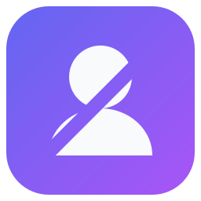
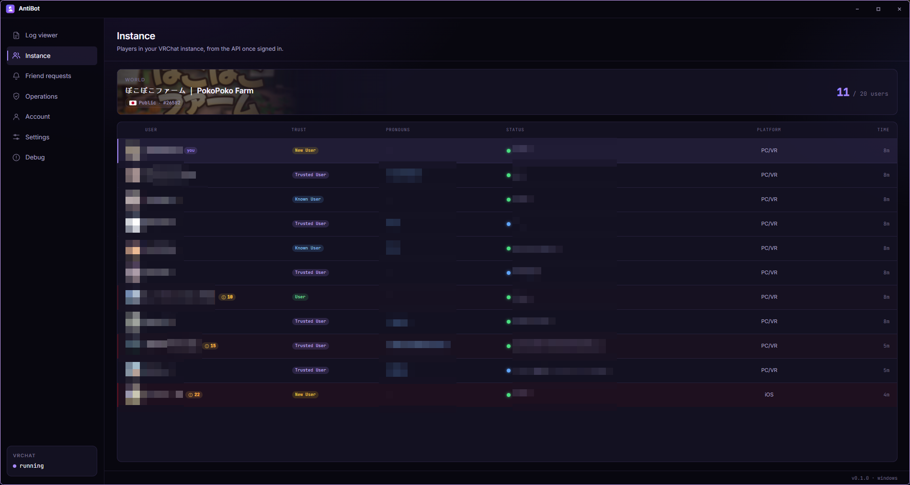
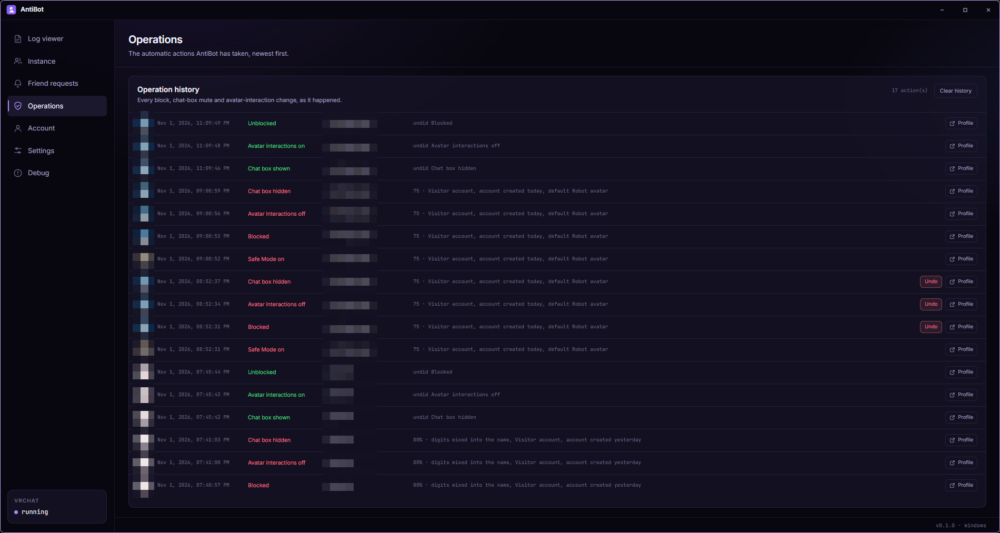
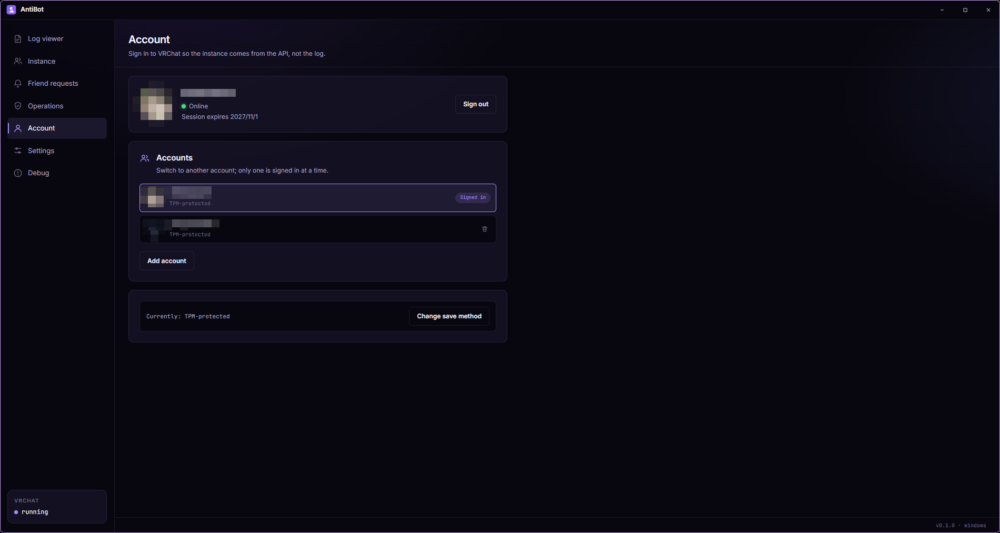

<div align="center">
  
  <h1>AntiBot</h1>
  <p><strong>让机器人远离你的 VRChat 实例。</strong></p>
  <p>
    <a href="https://t2penbix99wcoxkv3a4g.github.io/AntiBot/">网站</a> ·
    <a href="https://t2penbix99wcoxkv3a4g.github.io/AntiBot/#/docs/Getting-Started">文档</a>
  </p>
  <p>
    <a href="README.md">English</a> ·
    <a href="README.ja.md">日本語</a> ·
    <a href="README.zh-TW.md">繁體中文</a>
  </p>
</div>

AntiBot 会监视 VRChat 本来就会写入的日志，显示当前实例中有谁，并为每位加入的用户评分。当分数
超过你设置的阈值时，它可以在对方的头像下载完成前采取行动：屏蔽对方、关闭对方的头像交互、隐藏
对方的聊天框、通过 OSC 开启安全模式、切换到低风险头像，或关闭客户端。

不需要模组、插件或修改过的 VRChat 客户端。

<div align="center">
  <a href="docs/instance.png"></a>
  <br>
  <em>实例列表，每位用户都有威胁度分数</em>
  <br><br>
  <a href="docs/operations.png"></a>
  <br>
  <em>每个自动操作，连同原因与撤销功能</em>
  <br><br>
  <a href="docs/account.png"></a>
  <br>
  <em>多个账户，以及已保存的会话</em>
</div>

## 为什么需要

公开实例很容易成为机器人寻找头像、语音数据和账户链接的地方。AntiBot 会为加入的用户评分，
让你在头像下载完成前有时间反应。

分数只是推测，不是判定：真实的人可能得到高分，机器人也可能得到低分。每个原因都会连同自己的
分数列出，因此你能看出对方为何被标记。

## 功能

- **实时实例列表** — 实例中的每个人，包含信任等级、加入时间、平台、代词与威胁度分数。登录后
  列表来自 VRChat API，在此之前则来自日志。
- **威胁度评分** — 账户年龄、信任等级、生成的名称模式、个人资料文字与当前穿戴的头像都会纳入
  评分。每个迹象都会连同分数列出。
- **自动保护** — 达到阈值时，屏蔽该用户、关闭其头像交互并隐藏其聊天框。好友、白名单用户和
  你自己的账户永远不会被处理。
- **通过 OSC 开启安全模式** — 用户超过阈值时立即按下 VRChat 的紧急按钮，一次替换所有非好友
  的头像。
- **切换头像** — 可选择通过 OSC 将自己切换到低风险的头像 ID。不会自动切换回来。
- **好友请求** — 高威胁度的好友请求会被拒绝，并对发送者应用相同的处置操作。
- **日志查看器** — 实时、可搜索的 VRChat 日志查看，加入、离开与头像相关的行保持易读。
- **操作记录** — 每个自动操作都会连同分数和原因记录在 SQLite 中。大多数操作可以撤销。
- **批量操作** — 粘贴一组个人资料链接，对所有用户应用已启用的屏蔽、头像互动和聊天框操作，
  并通过符合速率限制的队列执行，附进度条。
- **多个账户** — 保留多个 VRChat 账户并在其间切换。会话可以保存在 Windows Hello、TPM、
  DPAPI、系统钥匙串或你选择的密码之后。
- **自动登录** — 可选择用 TPM 或 DPAPI 加密保存登录名和密码，会话过期时可重新登录。
  在账户页面开启，并选择自动登录或仅通过手动按钮使用；VRChat 仍可能要求二步验证或邮件确认。
- **数据留在本机** — 日志、数据库和设置都留在你的电脑上。网络连接只会前往 VRChat API，以及你配置
  的头像名称提供者。

## 技术构成

- **使用 .NET 10 上的 C#** — 所有逻辑：读取日志、与 VRChat API 通信、评分、处置操作、OSC 与
  本地数据库。
- **React 19 + TypeScript**，由 **Vite** 打包并使用 **styled-components** 设计样式 — 界面。它
  与 C# 端交换 JSON 消息，本身不执行任何工作。
- **Photino.NET** — 桌面外壳。它在操作系统自己的 WebView 中显示界面，因此 WebView 是运行时
  依赖项：Windows 上为 WebView2，Linux 上为 WebKitGTK。
- **SQLite** — 实例事件、玩家资料、好友请求与操作记录。

## 运行

发布的版本是 **自包含**的 —— 它们包含 .NET 运行时，因此不需要额外安装任何东西。操作系统仍需
提供下列项目。

除了纯压缩包外，还会发布四种软件包格式：

| 文件                                     | 用途                                                                                                                          |
|------------------------------------------|-------------------------------------------------------------------------------------------------------------------------------|
| `AntiBot-<version>-win-x64.msi`          | 每位用户的 Windows 安装程序：安装到 `%LOCALAPPDATA%\Programs\AntiBot`，添加开始菜单与桌面快捷方式，且永远不会要求管理员权限。 |
| `antibot-<version>-1.fcXX.x86_64.rpm`    | Fedora 软件包：`sudo dnf install ./antibot-<version>-*.rpm`。安装到 `/opt/AntiBot`，包含 `antibot` 命令、桌面入口与图标。     |
| `antibot_<version>_amd64.deb`            | Debian/Ubuntu 软件包：`sudo apt install ./antibot_<version>_amd64.deb`。布局与 RPM 相同。                                     |
| `antibot-<version>-1-x86_64.pkg.tar.zst` | Arch Linux 软件包：`sudo pacman -U antibot-<version>-1-x86_64.pkg.tar.zst`。布局与 RPM 相同。                                 |

### Windows

1. Microsoft Edge **WebView2 运行时**。Windows 10 和 11 通常已内置；否则请使用
   [Microsoft 的页面](https://developer.microsoft.com/microsoft-edge/webview2/)。
2. Windows 10 或更新版本，x64。
3. 此版本未进行代码签名，Windows 第一次启动时可能会显示警告。

### Linux

1. GTK 用的 WebView。
2. AppIndicator 库，仅用于系统托盘图标。没有它应用仍可运行，只是没有托盘，并会保持主窗口
   可见。
3. 自包含版本所需的 .NET 运行时库（ICU、OpenSSL、zlib、krb5、fontconfig、freetype）会由软件包
   一并安装。使用纯压缩包时需要自行安装。

| 发行版          | 软件包                                                                       |
|-----------------|------------------------------------------------------------------------------|
| Fedora          | `sudo dnf install webkit2gtk4.1 libayatana-appindicator-gtk3 libnotify`      |
| Debian / Ubuntu | `sudo apt install libwebkit2gtk-4.1-0 libayatana-appindicator3-1 libnotify4` |
| Arch Linux      | `sudo pacman -S webkit2gtk-4.1 libayatana-appindicator`                      |
| 其他            | 寻找提供下列库的软件包                                                       |

```
libwebkit2gtk-4.1.so.0          libjavascriptcoregtk-4.1.so.0
libgtk-3.so.0                   libglib-2.0.so.0
libayatana-appindicator3.so.1   （或较旧的 libappindicator3.so.1）
```

缺少 WebView 库时，启动会显示 `Unable to load shared library 'Photino.Native'`。若要找出缺少的
soname 属于哪个软件包，可以询问包管理器 —— 例如
`dnf provides 'libwebkit2gtk-4.1.so.0'`、`apt-file search libwebkit2gtk-4.1.so.0`，或
`pacman -F libwebkit2gtk-4.1.so.0`。

## 首次使用

1. **登录**你游玩用的 VRChat 账户。VRChat 要求时，AntiBot 会询问电子邮件代码与双重验证代码。
   密码只用于该次请求；只有开启自动登录时，才会加密保存。
2. **指向日志文件夹。** 默认是 VRChat 自己的文件夹：
   Windows 上为 `%USERPROFILE%\AppData\LocalLow\VRChat\VRChat`；Linux 上会自动寻找 Proton
   前缀。AntiBot 会跟随该文件夹中最新的 `output_log_*.txt`。
3. **设置 0 到 100 的阈值。** 低于阈值不会有任何操作，而每个分数的原因都会显示在列表中。
4. **选择操作。** 在 **设置 → 自动保护**中开启你要的项目。安全模式和切换头像需要 OSC；其他
   功能不需要。

完整说明请见[文档](https://t2penbix99wcoxkv3a4g.github.io/AntiBot/#/docs/Getting-Started)。

## 构建

- [.NET 10 SDK](https://dotnet.microsoft.com/download)
- [Node.js](https://nodejs.org/) 20 或更新版本，用于构建界面
- `AntiBot/Libs` 中的共享 DLL 与前端 bridge 包，从独立的
  [PhotinoNETUtils](../PhotinoNETUtils) 项目通过 `build-and-copy.ps1` 复制而来

## 构建与运行

### 开发

界面由 Vite 提供，因此两者都要运行：

```bash
# 终端 1 — 界面在 http://127.0.0.1:3200
cd AntiBot/UserInterface
npm install
npm run dev

# 终端 2 — 桌面应用
dotnet run --project AntiBot
```

Debug 版本会从开发服务器加载界面。“调试”页面只在 Debug 版本中提供。

### 发布

`npm run build` 会将界面复制到 `AntiBot/Resources/wwwroot`，项目再将它嵌入可执行文件 —— 因此
发布前必须先构建界面。

```bash
cd AntiBot/UserInterface && npm run build
cd ../.. && dotnet publish AntiBot/AntiBot.csproj -c Release -r win-x64
```

Linux 请使用 `-r linux-x64`。这会在 `AntiBot/bin/Release/net10.0/<rid>/publish/` 下生成一个
自包含的单一可执行文件。

## 文件存放位置

|            | Windows                                | Linux                                  |
|------------|----------------------------------------|----------------------------------------|
| 设置       | `%APPDATA%\AntiBot\settings.json`      | `~/.config/AntiBot/settings.json`      |
| 数据库     | `%APPDATA%\AntiBot\antibot.db`         | `~/.config/AntiBot/antibot.db`         |
| 账户       | `%LOCALAPPDATA%\AntiBot\accounts`      | `~/.local/share/AntiBot/accounts`      |
| WebView    | `%LOCALAPPDATA%\AntiBot\webview`       | `~/.local/share/AntiBot/webview`       |
| 提取的图标 | `%LOCALAPPDATA%\AntiBot\icon.ico`      | `~/.local/share/AntiBot/icon.png`      |
| 日志       | `%APPDATA%\AntiBot\logs\antibot-*.log` | `~/.config/AntiBot/logs/antibot-*.log` |

每个账户会将自己的会话、salt 与保存方式保存在自己的文件夹中，文件夹名称是账户 ID 的哈希。
账户索引只保存显示名称和上次使用时间。

日志会写入文件并同步到控制台，因此报告问题时只需附上日志文件。日志每天轮换，保留最近七份。
超过 30 天的实例事件会在启动时清除。

## 注意事项

- VRChat 必须在同一台机器上运行：AntiBot 会读取它的日志，因此只有在 VRChat 位于实例中时才会
  知道该实例。
- 登录后实例列表来自 API，否则来自日志。若实例不是你账户所拥有，API 的名册可能不完整，因此
  那里仍会使用日志。
- 关闭窗口会将应用缩到系统托盘。若希望启动时就隐藏，请在设置中开启 **隐藏启动**；没有托盘时
  一律显示窗口。
- API 大约每隔几秒才允许一次管理请求。AntiBot 会遵守这个频率，并重试被拒绝的请求，而不是放弃
  该操作。

## 致谢

- **[VRCX](https://github.com/vrcx-team/VRCX)** — 大部分 VRChat API 集成参考自 VRCX 的实现，
  包括端点、登录与双重验证流程、处置操作、头像查询格式，以及部分日志解析。VRCX 的 MIT 许可
  收录于 [LICENSE_VRCX](LICENSE_VRCX)。

## 许可

MIT —— 详见 [LICENSE](LICENSE)。
