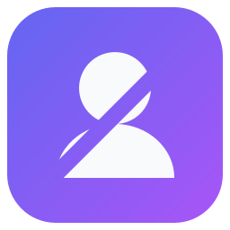
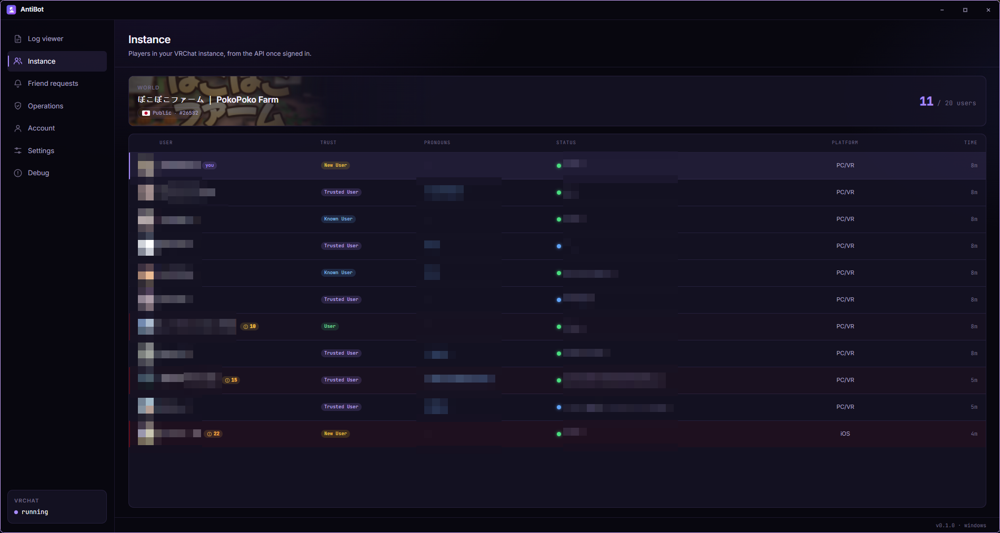
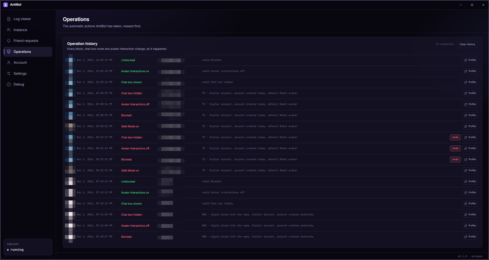
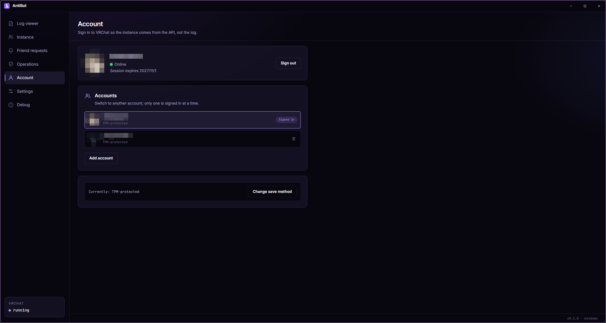

<div align="center">
  
  <h1>AntiBot</h1>
  <p><strong>把機器人擋在你的 VRChat 實例之外。</strong></p>
  <p>
    <a href="https://t2penbix99wcoxkv3a4g.github.io/AntiBot/">網站</a> ·
    <a href="https://t2penbix99wcoxkv3a4g.github.io/AntiBot/#/docs/Getting-Started">文件</a>
  </p>
  <p>
    <a href="README.md">English</a> ·
    <a href="README.ja.md">日本語</a> ·
    <a href="README.zh-CN.md">简体中文</a>
  </p>
</div>

AntiBot 會監看 VRChat 原本就會寫入的日誌，顯示目前實例中有誰，並為每位加入的使用者評分。當分數
超過你設定的門檻時，它可以在對方的頭像下載完成前採取行動：封鎖對方、關閉對方的頭像互動、隱藏
對方的聊天框、透過 OSC 開啟安全模式、切換到低風險頭像，或關閉用戶端。

不需要模組、外掛或修改過的 VRChat 用戶端。

<div align="center">
  <a href="docs/instance.png"></a>
  <br>
  <em>實例列表，每位使用者都有威脅度分數</em>
  <br><br>
  <a href="docs/operations.png"></a>
  <br>
  <em>每個自動操作，連同原因與復原功能</em>
  <br><br>
  <a href="docs/account.png"></a>
  <br>
  <em>多個帳號，以及已儲存的工作階段</em>
</div>

## 為什麼需要

公開實例很容易成為機器人尋找頭像、語音資料和帳號連結的地方。AntiBot 會為加入的使用者評分，
讓你在頭像下載完成前有時間反應。

分數只是推測，不是判定：真實的人可能得到高分，機器人也可能得到低分。每個原因都會連同自己的
分數列出，因此你能看出對方為何被標記。

## 功能

- **即時實例列表** — 實例中的每個人，包含信任等級、加入時間、平台、稱謂與威脅度分數。登入後
  列表來自 VRChat API，在此之前則來自日誌。
- **威脅評分** — 帳號年齡、信任等級、產生的名稱模式、個人資料文字與目前穿戴的頭像都會納入評分。
  每個跡象都會連同分數列出。
- **自動保護** — 達到門檻時，封鎖該使用者、關閉其頭像互動並隱藏其聊天框。好友、白名單使用者
  和你自己的帳號永遠不會被處理。
- **透過 OSC 開啟安全模式** — 使用者超過門檻時立即按下 VRChat 的緊急按鈕，一次替換所有非好友
  的頭像。
- **切換頭像** — 可選擇透過 OSC 將自己切換到低風險的頭像 ID。不會自動切換回來。
- **好友邀請** — 高威脅度的好友邀請會被拒絕，並對寄件者套用相同的處置操作。
- **日誌檢視器** — 即時、可搜尋的 VRChat 日誌檢視，加入、離開與頭像相關的行保持易讀。
- **操作紀錄** — 每個自動操作都會連同分數和原因記錄在 SQLite 中。大多數操作可以復原。
- **多個帳號** — 保留多個 VRChat 帳號並在其間切換。工作階段可以存放在 Windows Hello、TPM、
  DPAPI、系統鑰匙圈或你選擇的密碼之後。
- **資料留在本機** — 日誌、資料庫和設定都留在你的電腦上。網路連線只會前往 VRChat API，以及你設定
  的頭像名稱提供者。

## 技術組成

- **以 .NET 10 上的 C# 撰寫** — 所有邏輯：讀取日誌、與 VRChat API 通訊、評分、處置操作、OSC
  與本機資料庫。
- **React 19 + TypeScript**，由 **Vite** 打包並以 **styled-components** 設計樣式 — 介面。它與
  C# 端交換 JSON 訊息，本身不執行任何工作。
- **Photino.NET** — 桌面外殼。它在作業系統自己的 WebView 中顯示介面，因此 WebView 是執行階段
  相依元件：Windows 上為 WebView2，Linux 上為 WebKitGTK。
- **SQLite** — 實例事件、玩家資料、好友邀請與操作紀錄。

## 執行

發佈的版本是**自包含**的 —— 它們包含 .NET 執行階段，因此不需要額外安裝任何東西。作業系統仍需
提供下列項目。

除了純壓縮檔外，還會發佈四種套件格式：

| 檔案                                            | 用途                                                                                                                                                                 |
|-------------------------------------------------|----------------------------------------------------------------------------------------------------------------------------------------------------------------------|
| `AntiBot-<version>-win-x64.msi`                 | 每位使用者的 Windows 安裝程式：安裝到 `%LOCALAPPDATA%\Programs\AntiBot`，加入開始功能表與桌面捷徑，且永遠不會要求系統管理員權限。                                   |
| `antibot-<version>-1.fcXX.x86_64.rpm`           | Fedora 套件：`sudo dnf install ./antibot-<version>-*.rpm`。安裝到 `/opt/AntiBot`，包含 `antibot` 指令、桌面項目與圖示。                                              |
| `antibot_<version>_amd64.deb`                   | Debian/Ubuntu 套件：`sudo apt install ./antibot_<version>_amd64.deb`。配置與 RPM 相同。                                                                              |
| `antibot-<version>-1-x86_64.pkg.tar.zst`        | Arch Linux 套件：`sudo pacman -U antibot-<version>-1-x86_64.pkg.tar.zst`。配置與 RPM 相同。                                                                           |

### Windows

1. Microsoft Edge **WebView2 執行階段**。Windows 10 和 11 通常已內建；否則請使用
   [Microsoft 的頁面](https://developer.microsoft.com/microsoft-edge/webview2/)。
2. Windows 10 或更新版本，x64。
3. 此版本未進行程式碼簽章，Windows 第一次啟動時可能會顯示警告。

### Linux

1. GTK 用的 WebView。
2. AppIndicator 函式庫，僅供系統匣圖示使用。沒有它應用程式仍可執行，只是沒有系統匣，並會保持
   主視窗可見。
3. 自包含版本所需的 .NET 執行階段函式庫（ICU、OpenSSL、zlib、krb5、fontconfig、freetype）會由
   套件一併安裝。使用純壓縮檔時需要自行安裝。

| 發行版          | 套件                                                                     |
|-----------------|--------------------------------------------------------------------------|
| Fedora          | `sudo dnf install webkit2gtk4.1 libayatana-appindicator-gtk3 libnotify`  |
| Debian / Ubuntu | `sudo apt install libwebkit2gtk-4.1-0 libayatana-appindicator3-1 libnotify4` |
| Arch Linux      | `sudo pacman -S webkit2gtk-4.1 libayatana-appindicator`                  |
| 其他            | 尋找提供下列函式庫的套件                                                 |

```
libwebkit2gtk-4.1.so.0          libjavascriptcoregtk-4.1.so.0
libgtk-3.so.0                   libglib-2.0.so.0
libayatana-appindicator3.so.1   （或較舊的 libappindicator3.so.1）
```

缺少 WebView 函式庫時，啟動會顯示 `Unable to load shared library 'Photino.Native'`。若要找出
缺少的 soname 屬於哪個套件，可以詢問套件管理器 —— 例如
`dnf provides 'libwebkit2gtk-4.1.so.0'`、`apt-file search libwebkit2gtk-4.1.so.0`，或
`pacman -F libwebkit2gtk-4.1.so.0`。

## 首次使用

1. **登入**你遊玩用的 VRChat 帳號。VRChat 要求時，AntiBot 會詢問電子郵件代碼與雙重驗證代碼。
   密碼只用於那一次請求，絕不會被儲存。
2. **指向日誌資料夾。** 預設是 VRChat 自己的資料夾：
   Windows 上為 `%USERPROFILE%\AppData\LocalLow\VRChat\VRChat`；Linux 上會自動尋找 Proton
   前綴。AntiBot 會跟隨該資料夾中最新的 `output_log_*.txt`。
3. **設定 0 到 100 的門檻。** 低於門檻不會有任何動作，而每個分數的原因都會顯示在列表中。
4. **選擇操作。** 在**設定 → 自動保護**中開啟你要的項目。安全模式和切換頭像需要 OSC；其他
   功能不需要。

完整說明請見[文件](https://t2penbix99wcoxkv3a4g.github.io/AntiBot/#/docs/Getting-Started)。

## 建置

- [.NET 10 SDK](https://dotnet.microsoft.com/download)
- [Node.js](https://nodejs.org/) 20 或更新版本，用於建置介面
- `AntiBot/Libs` 中的共用 DLL 與前端 bridge 套件，從獨立的
  [PhotinoNETUtils](../PhotinoNETUtils) 專案以 `build-and-copy.ps1` 複製而來

## 建置與執行

### 開發

介面由 Vite 提供，因此兩者都要執行：

```bash
# 終端機 1 — 介面在 http://127.0.0.1:3200
cd AntiBot/UserInterface
npm install
npm run dev

# 終端機 2 — 桌面應用程式
dotnet run --project AntiBot
```

Debug 版本會從開發伺服器載入介面。「除錯」頁面只在 Debug 版本中提供。

### 發行

`npm run build` 會將介面複製到 `AntiBot/Resources/wwwroot`，專案再將它嵌入執行檔 —— 因此發佈前
必須先建置介面。

```bash
cd AntiBot/UserInterface && npm run build
cd ../.. && dotnet publish AntiBot/AntiBot.csproj -c Release -r win-x64
```

Linux 請使用 `-r linux-x64`。這會在 `AntiBot/bin/Release/net10.0/<rid>/publish/` 下產生一個
自包含的單一執行檔。

## 資料存放位置

|              | Windows                                       | Linux                                             |
|--------------|-----------------------------------------------|---------------------------------------------------|
| 設定         | `%APPDATA%\AntiBot\settings.json`             | `~/.config/AntiBot/settings.json`                 |
| 資料庫       | `%APPDATA%\AntiBot\antibot.db`                | `~/.config/AntiBot/antibot.db`                    |
| 帳號         | `%LOCALAPPDATA%\AntiBot\accounts`             | `~/.local/share/AntiBot/accounts`                 |
| WebView      | `%LOCALAPPDATA%\AntiBot\webview`              | `~/.local/share/AntiBot/webview`                  |
| 擷取的圖示   | `%LOCALAPPDATA%\AntiBot\icon.ico`             | `~/.local/share/AntiBot/icon.png`                 |
| 日誌         | `%APPDATA%\AntiBot\logs\antibot-*.log`        | `~/.config/AntiBot/logs/antibot-*.log`            |

每個帳號會將自己的工作階段、salt 與儲存方式保存在自己的資料夾中，資料夾名稱是帳號 ID 的雜湊。
帳號索引只保存顯示名稱和上次使用時間。

日誌會寫入檔案並同步到主控台，因此回報問題時只需附上日誌檔。日誌每天輪替，保留最近七份。
超過 30 天的實例事件會在啟動時清除。

## 注意事項

- VRChat 必須在同一台機器上執行：AntiBot 會讀取它的日誌，因此只有在 VRChat 位於實例中時才會
  知道該實例。
- 登入後實例列表來自 API，否則來自日誌。若實例不是你帳號所擁有，API 的名單可能不完整，因此
  那裡仍會使用日誌。
- 關閉視窗會將應用程式縮到系統匣。若希望啟動時就隱藏，請在設定中開啟**隱藏啟動**；沒有系統匣
  時一律顯示視窗。
- API 大約每幾秒只允許一次管理請求。AntiBot 會遵守這個頻率，並重試被拒絕的請求，而不是放棄
  該操作。

## 致謝

- **[VRCX](https://github.com/vrcx-team/VRCX)** — 大部分的 VRChat API 整合參考自 VRCX 的實作，
  包括端點、登入與雙重驗證流程、處置操作、頭像查詢格式，以及部分日誌解析。VRCX 的 MIT 授權
  收錄於 [LICENSE_VRCX](LICENSE_VRCX)。

## 授權

MIT —— 詳見 [LICENSE](LICENSE)。
